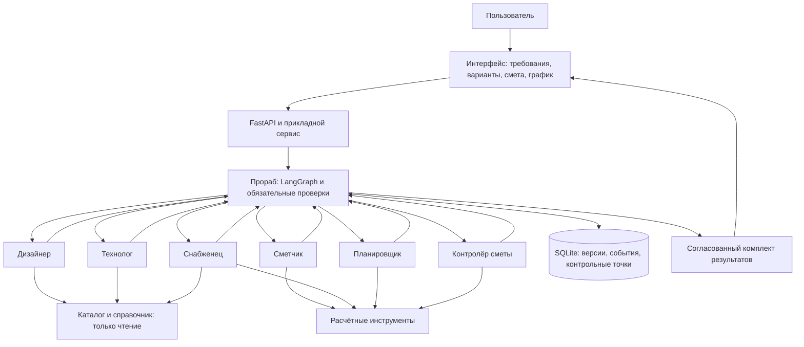

# Архитектура: управляемый граф и проверяемые результаты

Предложение к реализации от 16.10.2026. Лимиты и целевые показатели ниже — проектные значения, ещё не результаты измерений.

## 1. Основное решение

Один модульный сервис, семь логических агентов, структурированные документы и программные проверки. Прораб — единственный координатор. Последовательность обработки означает передачу документов через него, а не прямой обмен специалистов.

Модель не получает право записи в БД. Ответ агента — предложенный документ; прораб проверяет схему, ссылки, версию и ограничения, затем принимает его. Планировщик не меняет смету, снабженец не исключает подготовительные работы.

### Технологии и альтернативы

| Решение | Причина | Когда пересмотреть |
|---|---|---|
| Python 3.12, FastAPI, Pydantic | Продолжение учебного примера; один язык для API, инструментов и оценки | При появлении подтверждённого ограничения |
| HTML со стороны сервера и небольшой JavaScript | Каждый участник делает свою сквозную функцию без отдельной команды интерфейса | React при сложном редактировании и совместной работе |
| LangGraph | Явные состояния, условные переходы, сохранение и ожидание пользователя | Собственная машина состояний возможна; две системы координации одновременно не нужны |
| SQLite и постоянный том | Один процесс и небольшая демонстрация | PostgreSQL до нескольких рабочих процессов и существенной многопользовательской нагрузки |
| Один адаптер поставщика API | Меньше интеграционной работы; модель заменяется за общим контрактом | Второй поставщик после измерения риска доступности или качества |
| Каталог JSON/SQLite, поиск по словам и метаданным | Малому подготовленному справочнику не нужна векторная БД | Гибридный поиск после роста корпуса и измерения полноты |
| Docker, pytest, проверка стиля и типов | Воспроизводимость и проверяемость | Kubernetes, Kafka и отдельная сеть взаимодействия сервисов в MVP не нужны |

При продолжении после прерывания LangGraph может повторить код узла, выполненный до паузы. Поэтому подтверждение пользователя выносится в отдельный узел, а предшествующие действия должны безопасно повторяться. [Сохранение состояния](https://docs.langchain.com/oss/python/langgraph/persistence), [прерывания](https://docs.langchain.com/oss/python/langgraph/interrupts).

## 2. Роли и полномочия

| Агент | Вход | Результат | Инструменты и ограничения | Владелец |
|---|---|---|---|---|
| Прораб | Требования, состояние документов, замечания | Уточнения, решение о пересчёте, объяснение | Разрешённые маршруты; не отменяет обязательные ограничения | A |
| Дизайнер | Подтверждённые требования, словарь покрытий | Две концепции и требования к материалам | Палитры и иллюстративные примеры; без выдуманных товаров | B |
| Технолог | Концепция, размеры, состояние основания | Работы, потребности, риски | Шаблоны и совместимость; неподдерживаемое решение помечается | B |
| Снабженец | Потребности, объёмы, регион | Предложения, покупки, аналоги | Каталог только для чтения; без оформления заказов | C |
| Сметчик | Работы, закупки, тарифы, резерв | Смета по статьям | Расчётный инструмент; LLM классифицирует и объясняет | C |
| Планировщик | Работы, поставки, календарь | График, сроки закупок, конфликты | Алгоритм графа и календаря; LLM интерпретирует пожелания | D |
| Контролёр | Первичные данные и итоговые документы | Замечания с важностью, доказательствами и исправлениями | Только чтение; независимый список проверок; не переписывает смету | D |

У специалистов отдельные контексты и инструкции. Сметчик и контролёр могут использовать одну модель, но не общую историю сообщений. Это разделение контекстов и полномочий; преимущество над одним агентом ещё нужно измерить.

## 3. Последовательность и состояния

1. Проверка размеров и бюджета. Прораб извлекает пожелания в черновик требований.
2. При отсутствии важных данных — `needs_input` («нужны сведения»). В полном MVP не более двух автоматических раундов вопросов, затем форма оставшихся полей.
3. Подтверждение версии требований; две концепции и отдельное событие выбора.
4. Технолог составляет работы и потребности. Код проверяет размеры, полноту шаблонов и совместимость.
5. Снабженец выбирает разрешённые артикулы; расчётный инструмент определяет упаковки. Если товар требует иной подготовки, прораб возвращает результат технологу.
6. После фиксации работ и закупок смету и график можно считать параллельно. На предварительной защите допустима последовательная обработка.
7. Контролёр проверяет комплект и возвращает замечания. Код отдельно сравнивает стоимость с бюджетом и дату окончания со сроком.
8. При нарушении прораб запускает нужную ветку исправления. Изменение обязательных пожеланий требует `needs_approval` («нужно подтверждение»).
9. Успех — `completed`; нерешённые ограничения — `constraints_unresolved`; техническая ошибка — `failed`; превышение лимита — `stopped_limit`; отмена — `cancelled`.

Статус `completed` подтверждает согласованность модели плана, а не гарантирует цену реального ремонта. Состояние запуска отделено от результата аудита (`passed`, `failed`, `incomplete`) и проверки ограничений (`satisfied`, `violated`, `unknown`).

### Ограничение попыток

К предварительной защите: первоначальная попытка и одно исправление. Полный MVP: первоначальная попытка и максимум два исправления. На шаг — одна генерация и не более одного исправления формата. При временных технических ошибках — максимум две повторные попытки. Все вызовы входят в общий счётчик.

Стартовые пределы: 30 вызовов LLM, 60 вызовов инструментов, 180 секунд активной работы. Ожидание пользователя исключено из времени исполнения. Денежный предел задаётся до запуска. При неизвестном тарифе платный запуск требует консервативной оценки стоимости.

Новый пользовательский запрос создаёт новый запуск, но общая квота проекта не даёт обходить лимит повторными нажатиями. Отпечаток существенных решений включает требования, артикулы и обязательные работы. Повтор того же решения без устранения замечаний прекращает цикл.

## 4. Данные и контракты

Общие служебные поля: `schema_version`, `project_id`, `run_id`, `input_revision`, `artifact_id`, `created_at`, `source_ids`, `assumptions`, `status`. Они описывают схему, проект, запуск, версии, источники, допущения и состояние.

Деньги — целые копейки либо Decimal с явным округлением. Дробные значения в JSON передаются строками. У количества есть единица измерения. Даты — ISO 8601; календарь и часовой пояс указаны явно.

| Объект | Содержание и обязательные свойства |
|---|---|
| Требования — `RenovationBrief` | Размеры, проёмы, основание, бюджет, валюта, регион, начало и конец, календарь, обязательные и желательные условия, исключённые работы. Неизвестное не равно нулю |
| Концепция — `DesignConcept` | Идентификатор, палитра, типы покрытий, соответствие пожеланиям, иллюстративные источники. Окончательной цены ещё нет |
| Работа — `WorkItem` | Устойчивый идентификатор, объём и единица, предшественники, трудозатраты, календарные паузы, бригада, материалы, источники |
| Потребность — `MaterialRequirement` | Связь с работами, категория, совместимость с основанием и покрытием, объём, правила запаса и источник |
| Товар и предложение — `CatalogItem`, `Offer` | Артикул, поставщик, упаковка, цена, валюта, наличие, срок и правила доставки, регион, дата получения и срок действия, тип источника |
| Покупка — `PurchaseLine` | Потребности, товар и предложение, упаковки, закупаемый объём, запас и излишек. Одна покупка может обеспечивать несколько работ |
| Строка сметы — `EstimateLine` | Вид расхода, ссылки на работу/покупку/доставку, количество, ставка, сумма и источник; уникальный ключ против дублей |
| Смета — `Estimate` | Материалы, работа, доставка, расходники, вывоз при включении в объём, база и ставка резерва, итог. Неизвестные суммы отдельным списком |
| Этап графика — `ScheduleItem` | Работа, раннее и плановое начало, окончание, паузы, предшественники, ресурс и доступность материалов |
| Замечание — `Finding` | Идентификатор, важность, код, ссылки, подтверждающие данные, ответственный и необходимое исправление. Одной фразы «исправлено» недостаточно |
| Аудит — `AuditReport` | Проверенная версия, результаты проверки арифметики, полноты, совместимости и графика; замечания и состояние |
| Комплект — `PlanBundle` | Согласованные версии всех документов, выполнение ограничений и оговорки |
| Источник — `SourceRecord` | Ссылка либо идентификатор примера, тип, время получения, хеш, извлечённые поля, единицы, проверяющий и условия использования при необходимости |
| Событие — `RunEvent` | Запуск, узел, версия, попытка, входные и выходные документы, поставщик API, модель, токены, оценочная/фактическая стоимость, задержка и исход |

Агент возвращает документ либо структурированное сообщение о нехватке сведений, неподдерживаемой задаче или временной ошибке. Пустой JSON, неизвестные идентификаторы и неверные единицы не считаются частичным успехом.

### Проектируемый API

| Операция | Поведение |
|---|---|
| `POST /projects` | Создать черновик требований, вернуть идентификатор и версию |
| `PATCH /projects/{id}/brief` | Изменить требования по ожидаемой версии; конфликт — 409 |
| `POST /projects/{id}/runs` | Запустить расчёт с версией требований и ключом идемпотентности; ответ 202 и идентификатор |
| `GET /runs/{id}` | Получить состояние, этап, ошибки и готовые результаты |
| `POST /runs/{id}/decisions` | Подтвердить выбор или компромисс с идентификатором решения и ожидаемой версией |
| `POST /runs/{id}/cancel` | Отменить; повтор отмены безопасен, новые шаги не запускаются |
| `GET /projects/{id}/plans/{revision}` | Прочитать неизменяемый комплект заданной версии |
| `GET /projects/{id}/plans/{revision}/export` | Получить JSON, HTML для печати и CSV покупок |

Это проектируемые, а не существующие методы. Для предварительной защиты допустим синхронный расчёт через тот же прикладной сервис. Сохранённая фоновая задача и опрос состояния относятся к полному MVP. Поток событий SSE необязателен.

## 5. Расчётные правила

Прямоугольная комната: площадь пола = длина × ширина; площадь стен = 2 × (длина + ширина) × высота − площадь проёмов. Размеры положительные, проёмы не больше поверхности, единицы совместимы. Одной площади недостаточно для восстановления всех размеров.

Потребность учитывает площадь, расход на слой или м², число слоёв и запас. Число упаковок = округление вверх отношения потребности к вместимости упаковки. Цена применяется к купленным упаковкам. Одинаковые артикулы объединяются только при одинаковой спецификации и совместимых требованиях; распределение по работам сохраняется. Доставка считается на заказ у поставщика, а не на каждую строку.

Сумма до резерва = материалы + работа + доставка + прочие включённые расходы. Резерв = округлённое произведение этой суммы на ставку резерва. Итог = сумма до резерва + резерв. База фиксируется в настройках и выгрузке. Учебные 10% — параметр сценария, не строительная норма. Запас материалов и денежный резерв различаются. Неизвестная доставка запрещает считать итог полностью проверенным.

График: проверка ацикличности, топологический порядок, размещение работ одной бригады. Начало не раньше завершения предшественников с паузами, поступления материалов, доступности бригады и старта проекта. Труд занимает рабочие часы, ожидание идёт календарно. Выходные задаются календарём. Критический путь без ресурсов — нижняя граница; оптимальность расписания с ресурсными ограничениями в MVP не обещается. Неизвестный календарь доставки отмечается как допущение.

### Контрольный пример с вымышленными ценами

Комната 4 × 5 × 2.7 м, проёмы 4 м²: пол 20 м², стены 44.6 м². Краска: 0.1 л/м²/слой × 2 слоя × запас 10% = 9.812 л, то есть 2 банки по 5 л. Пол с запасом 10%: 22 м², то есть 10 упаковок по 2.2 м². Коэффициенты учебные, не рекомендация по технологии.

Краска 6000 ₽, пол 20000 ₽, грунт и прочие материалы 4000 ₽, работа 35000 ₽, доставка 2500 ₽. До резерва 67500 ₽, резерв 6750 ₽, итог 74250 ₽. При бюджете 70000 ₽ не хватает 4250 ₽. Совместимый пол по 1600 ₽ за упаковку даёт 63500 ₽ до резерва и 69850 ₽ с резервом. Это проверка расчёта, а не достоверная рыночная смета.

## 6. Независимый контроль

Контролёр сначала получает требования, работы, каталог и правила. Самостоятельно составляет ожидаемый список, затем сопоставляет смету, закупки и график. Самооценка сметчика не является доказательством. Общая денежная арифметика допустима, но проверка полноты не должна повторять сборку сметы.

Код проверяет арифметику, ссылки, единицы, обязательные задачи, дубли, поставки, граф и версии. LLM проверяет сохранение пожеланий, основания замены и объяснение дорогих статей. Субъективное «дорого» без сравнения не блокирует результат автоматически. Реальная пригодность технологий требует проверенных документов и специалиста; агент не заменяет эту проверку.

## 7. Пересчёт и согласованность

| Изменение | Что пересчитывается |
|---|---|
| Размеры, проёмы, основание | Работы → потребности → закупки → смета и график → аудит |
| Концепция или покрытие | Технология и все зависимые результаты |
| Артикул, упаковка, доставка | Совместимость → закупки → смета и график → аудит; новые работы возвращаются технологу |
| Только цена | Закупочная цена → смета → аудит; график сохраняется со ссылкой на входные данные |
| Бюджет или пожелания | Проверка выполнимости и варианты; изменённое решение делает зависимые документы устаревшими |
| Срок или календарь | График → аудит; дополнительные ресурсы меняют также смету |

Для предварительной защиты безопаснее пересчитывать весь комплект. В полном MVP результат узла можно повторно использовать лишь при совпадающем отпечатке входов. Транзакция БД публикует итог атомарно. Изменение требований делает активный запуск устаревшим; поздний ответ не становится текущим планом.

## 8. Надёжность, доступ и наблюдаемость

- Контрольная точка сохраняется после принятия документа. Повтор внешнего вызова при сбое возможен, но повтор принятия блокируется идентификаторами запуска, узла, версии и попытки, а также хешем. Однократное списание средств внешним API не гарантируется.
- При тайм-ауте или HTTP 429 — ограниченные повторы с увеличением задержки и случайным разбросом, затем явная ошибка. Сохранённый ответ не выдаётся за новый.
- Ключ кеша учитывает модель, инструкцию, схему, версию проекта и данных. Личный контекст не переносится между проектами.
- Перед публичным доступом нужны авторизация, принадлежность проекта пользователю, квоты и серверное хранение ключа. UUID сам по себе не ограничивает доступ. Один локальный пользователь допустим только до развёртывания.
- Описания товаров — данные, а не инструкции. Поля извлекаются по схеме, инструменты ограничены списком, неизвестные артикулы отклоняются. Агентам не доступны командная оболочка, исполнение кода и произвольный браузер.
- Произвольные внешние ссылки не загружаются. Будущий загрузчик ограничивает домены, внутренние IP-адреса, перенаправления, размер ответа и тип файла.
- HTML экранируется, CSV защищается от внедрённых формул. Ключи, точные адреса и лишние личные данные не записываются в журнал.
- Журнал содержит узел, версию входа, коды замечаний, токены, повторы, длительность, стоимость и идентификатор выполнения. Нужны краткие объяснения и наблюдаемые действия, а не скрытая цепочка рассуждений.

## 9. Развитие до полноценного продукта

| Этап | Добавления | Условие перехода |
|---|---|---|
| Учебный MVP | Снимок каталога, одна комната, ограниченные исправления, сохранение и оценка | Выполнены задачи 01–24, настоящий показ и воспроизводимость |
| Пилот | Региональный каталог, актуализация цен, экспертные правила, несколько комнат, отзывы | 10–20 планов с оценкой специалиста; ошибки классифицированы, качество источников измерено |
| Первая продуктовая версия | PostgreSQL, очередь и рабочие процессы, объектное хранилище, роли доступа, совместная работа, резервное копирование | Изоляция проектов, восстановление копии, целевые показатели качества и бюджет клиента |
| Расширенное планирование | CP-SAT/MILP для материалов, ресурсов и сроков; варианты по Парето и сценарии риска | Достаточно проверенных норм; алгоритм проверен на известных оптимумах и ограничении времени |
| Сопровождение ремонта | Фактические закупки, согласование изменений, план и факт, подрядчики, уведомления | Предложение отделено от внешнего действия; права, подтверждения и аудит |
| Работа с изображениями и BIM | Геометрия по чертежу или фото с ручной проверкой, визуализация | Измерена ошибка извлечения; размеры подтверждаются пользователем |

Целевая последовательность: интерфейс → API и авторизация → хранилище проектов и очередь → рабочие процессы прораба → ограниченные инструменты агентов → загрузка каталогов, поиск знаний и расчётный алгоритм → проверка → подтверждение → выгрузка.

Сначала PostgreSQL и очередь. Отдельные сервисы нужны при независимых требованиях к доступности или масштабированию. MCP полезен для внешних инструментов с устойчивым контрактом; A2A — для независимых команд и сервисов агентов. Добавлять их только ради технологии не нужно.

Нормы расхода, паузы и ограничения должны иметь регион, материал, условия, версию, первичный источник и статус экспертной проверки. Необоснованная точность хуже честного диапазона. До калибровки на фактических ремонтах диапазоны называются сценарными, а не вероятностными.

### Решения, которые стоит зафиксировать отдельно

ADR-01: модульный монолит. ADR-02: прораб и ограниченная последовательность этапов. ADR-03: неизменяемые документы и версии. ADR-04: объёмы, деньги и календарь кодом. ADR-05: снимок каталога раньше живой интеграции. ADR-06: независимый контроль и обязательные проверки. ADR-07: оценка внешнего поведения до усложнения системы. ADR-08: подтверждение изменения состава работ пользователем.

ADR — запись архитектурного решения с причинами и альтернативами. Принять эти решения в первый день разработки, без отдельного большого инфраструктурного этапа.
